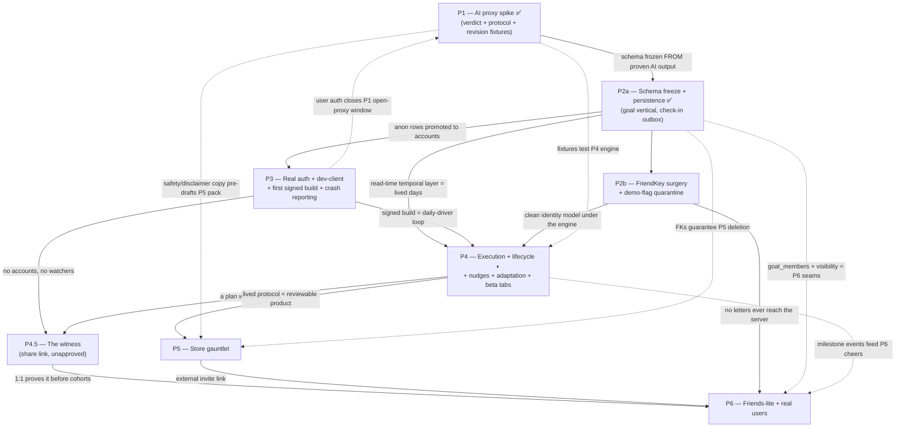

# Qleck — Master Roadmap

> **Status: APPROVED** (2026-08-23) — all three sign-offs granted by the owner same day.
> **Amended 2026-08-26** to match what actually shipped (see §0). The spine, the
> invariants and the risk register stand as approved; the amendment records
> delivery, owner decisions taken since, and re-scopes Phase 4.
> Produced via a 14-agent
> planning workflow: codebase audit + capability map, four competing roadmap lenses
> (AI-core-first / Foundation-first / Retention-first / Lean-de-risk), a 3-judge panel
> (unanimous winner: the Lean-de-risk spine), synthesis, then three adversarial critiques
> (22 findings folded in).
>
> Owner sign-offs — **all approved 2026-08-23**:
> 1. Photo-required profile **deferred past beta** (a deviation from AGENTS.md Phase 2; R2 seam preserved).
> 2. **Plans / Polls / Friends hidden** behind the demo flag in non-demo beta builds until Phase 6.
> 3. **Email-only auth** for beta (phone path hidden, social buttons removed until SIWA+Google ship together).

## 0. Where we actually are (amended 2026-08-26)

**Phase 1 ✅ and Phase 2a ✅ are complete and deployed.** Roughly half of what
shipped since approval was never in this plan — recorded here so the doc stops
being wrong about the product's own data model.

**Owner decisions taken after approval** (these override the text below wherever
they conflict):

| Decision | Date | Effect |
|---|---|---|
| **Concurrent goals** — creation never replaces | 08-24 | Up to 5 active goals; a goal ends only by explicit drop or completion. The single-goal assumption throughout P1/P2a is void. Never re-add it. |
| **Atomic Habits is the operating theory** | 08-25 | The habit loop + Four Laws (and their inversions) govern every generated protocol. See §2. |
| **One appearance for the whole product** | 08-25 | Light/dark/system drives BOTH palettes. The "Electric Night is the coach's permanent sub-brand" rule in AGENTS.md is retired. |
| **Protocols name themselves** (`short_title`) | 08-25 | List headers stopped being a regex guess at which words were goal vs method. |
| **Goals end deliberately** | 08-26 | Completion + graduation shipped — the first slice of P4, pulled forward. |

**Shipped off-plan:** the Today and Goals canvas ports (two-column desktop
Today, Goals as shelf + phase accordion), the three-sense reward ladder
(confetti / haptics / sound, tiered per rep → per goal → per day → per plan),
domain-aware goal suggestions (a chip is never offered for something already in
flight), and quantity logging on phone.

**Prompt version is 13** (v11 Atomic Habits, v12 `short_title`, v13
maintenance). Any prompt change bumps it and must re-clear the harness bars.

**Known gaps, ranked** — the honest backlog behind the phases below:
no nudges of any kind (the cue lives outside the product); milestones are only
evaluated at graduation, never live; "never miss twice" is a stance the app
doesn't act on; no history beyond the current week; two dead settings rows;
accessibility never audited. Test coverage is one fixture script over the
temporal layer (`npm run check:time`) plus the eval harness — still no runner.

## 1. North star

Functional means a stranger can install Qleck from TestFlight, sign up with a real email, type any goal in their own words, get an AI feasibility verdict (with counter-offer or safe refusal), accept a generated step-by-step protocol, and live it day by day — check-ins, streaks, nudges — with data that survives restarts, reinstalls, and a second device. Strong foundation means the D1 schema, auth model, and AI pipeline are set from evidence and **additive-only after Phase 2**, so Phase 2/3 AGENTS.md features (photo, health import, calendar, groups) attach through pre-reserved seams instead of destructive migrations. The sequencing rule: every phase retires exactly one product-killing risk and ends in something the owner can feel on his phone.

## 2. Architecture decisions

**Backend: Cloudflare Workers + D1 + R2, one new `qleck-api` Worker project.**
Owner already runs a production app on this paid stack (D1, DOs, auth, push); it is proven, cheap, and requires zero new platform learning. Tables and endpoints named `qleck_*` from the first migration — the Rally naming drift stays client-side only. R2 arrives with photos (deferred); Durable Objects only if realtime group features ever demand them.

**Data model: Goal is the atom.** `users(UUID)` → `goals` (free-text + accepted-statement version, status, timezone, `visibility` column `private|cheerable|group` from day one) → `protocols` (versioned JSON + version history) → `protocol_steps` / dated `scheduled_reps` (typed binary | quantity+unit | duration) → `check_ins`. Two hard invariants, declared in the schema doc before anything freezes:

> **Amended 08-24/08-26 — goals are concurrent and they end.** A user runs up to
> **5 active goals** at once; `POST /goals` never abandons anything. The
> lifecycle is `active → completed | abandoned` (`paused` still unused), written
> only by explicit action — nothing auto-completes on a cron, because the
> graduation moment belongs to the user. `protocols.version` is live: extending
> a plan appends version N+1 (the first writer past v1). Three invariants the
> completion work established, easy to regress:
> 1. **Extend passes `currentWeek = duration + 1`.** `reviseProtocol` freezes
>    phases with `end_week < currentWeek`; passing the duration itself leaves
>    the weeks just lived unprotected and deletable.
> 2. **The frozen past is spliced server-side**, not merely validated — which
>    also protects earned milestones, since attainment is derived at read time
>    and a dropped milestone would retroactively un-earn itself.
> 3. **Check-ins are never gated on status.** A 400 would wedge the offline
>    outbox head forever, silently stopping sync for every other goal.

1. **Check-ins are anchored to `(goal_id, user_id, local_date, rep descriptor, client UUID)` — never FK-cascaded from `protocol_steps`.** Delete-cascades hang only off `users` (and per-goal delete off `goals`). A protocol revision can therefore never eat check-in history.
2. **Past `scheduled_reps` and `check_ins` are immutable; revisions regenerate only future reps; steps carry stable IDs across protocol versions** ("we kept your Tuesday run, shortened it"). Revision-shaped fixtures run in the Phase-1 harness so adaptation semantics inform schema v1 *before* the freeze, not two phases after.

A **`goal_members` join table** (goal_id, user_id, role, joined_at) is reserved in the product migration alongside `visibility` — since check_ins already carry user_id, team totals and streak leaderboards later become aggregation queries, not schema surgery. The shipped Challenge/WeekDots surfaces become derived views over this hierarchy; their *social* faces (leaderboards, contributions, with-friends create) go behind the demo flag until Phase 6 gives them a real backend. GDPR is a schema property: delete-cascade FKs, export shape, and a split `ai_requests` design — a metadata row (model, tokens, cost, verdict class; retained long-term, no user text) and a payload blob (prompt/response text; 30-day retention; harness runs marked synthetic and exempt).

**Migrations, honestly numbered:** `0001` ships in **Phase 1** — `ai_requests` + `coach_sessions` only, ops tables outside the freeze. `0002` ships in Phase 2a — the product schema, free to reshape 0001's tables.

**IDs + sync:** Client-minted UUIDs; server-authoritative D1 with an AsyncStorage cache. The queued-mutation outbox is **scoped to check-ins only** — the one append-mostly, genuinely-offline flow; goals/protocols are created online with the AI in the loop anyway (optimistic UI + simple retry). Three sync invariants: every mutation carries its client UUID as a server-side idempotency key (INSERT OR IGNORE — no double-counted kilometers on retry); check_ins carry a client-asserted `local_date` that is authoritative for streak math; streaks/milestones are always **derived at read time, never stored** — Phase-6 feed events render from derived state. Deliberately **not** CRDT/offline-first; hold that line ruthlessly.

**Per-goal privacy:** enforced in every API query — the server never serializes a private goal's existence to non-owners. Private by default; `cheerable` opens in Phase 6; `group` is a reserved seam. Flipping private→shared re-runs the safety classifier before anything reaches a feed.

**AI pipeline (live from day one, never mocked, never naked):** *(Amended 2026-08-23, owner call: the provider is pluggable — DeepSeek (`AI_PROVIDER=deepseek`, default) carries the beta for cost, ~$0.005/goal; the Claude path stays wired and warm behind the same `callModel()` surface for when coach quality matters. Server-side schema validation + retry is the correctness backstop either way.)* all Claude calls go through the Worker — key in Worker secrets only, prompt templates versioned server-side. The intake/negotiation flow is a *conversation*, so its state lives server-side: a `coach_sessions` table holds the transcript and turn count; the client sends only `session_id` + the new message, and the 3–5-question band and safety verdict are enforced per session on the server — a tampered client cannot replay an edited transcript or loop past the cap. Flow: free-text intake (+3–5 clarifying questions: three are guaranteed, four and five only when the readiness auditor says a plan-critical fact is still missing) → cheap-model safety pre-classifier (refusal templates with crisis/professional resources; goal text is data, never instructions) → feasibility verdict as tool-use JSON `{feasible | counter-offer | declined}` → protocol generation (top-tier model, server-side schema validation, regenerate-on-invalid; AI output enters the app only by round-tripping the versioned schema) → adaptation, **user-triggered** in v1, future-reps-only per the immutability invariant. Cost rails congenital to the proxy: model tiering, prompt caching, per-device/user quotas, token+cost logging, kill-switch env flag.

**The coach's operating theory (owner call, 2026-08-25): Atomic Habits.**
Every protocol is applied behaviour design, not a generic to-do list. Behaviour
runs on the habit loop (cue → craving → response → reward); building a habit
applies the Four Laws (obvious / attractive / easy / satisfying) and breaking
one applies their inversions (invisible / unattractive / difficult /
unsatisfying). The coach diagnoses the loop from the intake answers, then
attacks cue and response *before* asking for willpower. Two consequences that
bind the implementation: the app's own check-in and streak **are** the Fourth
Law, so a "track it in the app" step is filler and is banned; and the framework
is how the coach *thinks*, never how it talks — framework vocabulary ("cue",
"habit stacking", "Law 3") is banned from every user-facing field. For
habit-breaking goals the intake treats the habit's **trigger context** as a
plan-critical fact worth one of its questions. "Never miss twice" is the
revision stance: an eased week is the immediate smaller way back, never "try
harder". Verified by a judge panel over generated protocols, not by assertion.

**Auth:** email magic-link/OTP via **Resend** (MailChannels' free Workers path is dead) + password/reset, wired into the existing funnel by swapping the mock branches in `useOnboardingFlow.ts` — the `nav()` state machine and copy are preserved, but real auth adds per-action loading/error/expired-code states across ~6 actions, and two deliberate funnel edits: the **phone-number path is hidden** (email-only beta; branches kept recoverable behind the demo flag until SMS is un-deferred) and the **socialJoin button is removed** (that's what keeps deferred SIWA clear of Apple 4.8). JWT access + refresh with revocation (owner's battle-tested invariants), SecureStore on native with an explicit web token strategy defined in P3. ToS + privacy-policy acceptance is a P3 signup deliverable, not a P5 retrofit. Sending domain gets SPF/DKIM/DMARC with an inbox-not-spam test before the funnel swap is called done.

**Identity claiming is row promotion, not migration:** the anonymous device row **IS** the user row — sign-up attaches an email identity to the existing `users.id` (one UPDATE + an `identities` INSERT; FKs untouched; no merge engine). The one conflict case is decided now: signing in on a device whose anon account has data, into an account that already exists → server wins; the anon rows are orphaned-and-logged after a confirm prompt, never merged. Claim is one-way and once. Anon accounts idle >90 days are garbage-collected (closes the GDPR orphan of free-text health goals nobody can delete). Android's keychain does not survive reinstall; pre-auth data loss there is accepted and documented.

**Decided conflicts:**
- *FriendKey surgery timing:* its own phase (2b), immediately after persistence, incremental compiling steps gated by a written regression checklist — not quarantined until Phase 6, not a Phase-1 big-bang, and **not welded to the sync-engine build** (both rewrites run through `RallyContext.tsx`; doing them simultaneously in a test-free codebase is the plan's likeliest multi-week stall).
- *Mock social surfaces:* beta tab layout is **Today / Goals / You**. Plans, Polls, and Friends are feature-flagged OFF in non-demo builds from the first signed build, flipping back per-surface as Phase 6 delivers each a real backend. A fresh real account never sees fake friends or dead polls.
- *Adaptation cadence:* on-demand in v1; cron only after demand shows.
- *Push:* locally scheduled `expo-notifications` first; server push arrives with cheers. The onboarding primer stays a soft pre-prompt; the one-shot iOS OS permission request fires at **first protocol acceptance**, never inside the signup funnel.
- *Photo-required:* deferred past beta **as an explicit AGENTS.md deviation the owner must sign off**; profile row + R2 seam preserved.

## 3. The phases

### Phase 1 — Real coach, zero accounts (AI proxy spike) — **M**
**Objective:** prove the brain end-to-end — safety gate, verdict with counter-offer, schema-valid protocol — while product state is still ephemeral and cheap to change.

- [x] `qleck-api` Worker (dev + prod, CORS for :8090) with `/coach` endpoints; provider key in Worker secrets only (**DeepSeek** by default per the 08-23 amendment); **migration 0001: `ai_requests` (metadata/payload split) + `coach_sessions` — ops tables, explicitly outside the product freeze**
- [x] Server-held coach sessions: transcript + turn count in D1, negotiation capped server-side (**shipped at 4 turns**, not 2–3 — plans that prescribe personal numbers must collect the inputs first)
- [x] Safety pre-classifier (cheap tier) + refusal templates with crisis/professional-help copy; injection hygiene (goal text = data)
- [x] Feasibility verdict as validated tool-use JSON, one retry on invalid
- [x] `protocol_schema` v1, versioned: phases, typed reps, milestones, **stable step IDs** — shaped for the existing WeekDots/streak UI
- [x] Cost rails from call #1: tiering, prompt caching, per-device+IP quota with clean 429, kill-switch, token/cost logging
- [x] Client: FirstGoalScreen picker → free-text intake reusing the Qoach advice-card; ProtocolPreview screen; the app's first loading/error/retry states
- [x] Hand-author 3–4 protocol templates against schema v1 — human-fillability test + permanent eval fixtures
- [x] Automated eval harness — ~20 canned goals (realistic/unrealistic/unsafe/injection) **+ 2–3 "revise this in-flight protocol" fixtures** so revision output shapes inform the schema before Phase 2a freezes it — replayed against live endpoints, scored from `ai_requests`
- [x] Draft not-medical-advice disclaimers, health-claim framing rules, and Apple age-rating/AI-questionnaire answers in the same pass as the refusal copy
- [x] Web preview stays private until real auth lands

**Exit:** "run a 4k in 6 weeks" → verdict + rendered multi-week protocol on web AND Expo Go in ~20s; "lose 15kg in 2 weeks" → counter-offer; unsafe goal → supportive refusal with resources; injection goal analyzed as data; revision fixtures produce future-only, stable-ID revisions; harness ≥95% schema-valid within 2 attempts and 100% unsafe refusal (fixed bar — no prompt-polish past it); grep of repo + exported bundle finds no key; per-goal cost in the cents band.
**Retires:** the product-killing unknown — that the coach can't produce a credible, safe, affordable verdict + protocol.
**Result (08-24):** cleared. Harness **ALL BARS CLEAR** — 24 goal fixtures + 3 revision fixtures, 100% unsafe refusal, 11/11 protocols schema-valid, revisions past-preserving, zero leaks; whole run ≈ $0.07. Re-cleared on every prompt bump since (v11, v12, v13).

### Phase 2a — Schema freeze + persistence (goal vertical) — **M**
**Objective:** freeze the product schema from Phase-1 evidence (additive-only afterward); make coach data survive restarts and offline — without touching the identity model yet.

- [x] Migration 0002: `users`, `identities` (reserved), `goals` (+visibility), **`goal_members` (reserved)**, `protocols`, `protocol_steps`, `scheduled_reps`, `check_ins` (goal_id + user_id + local_date + client UUID anchoring) — delete-cascade FKs off `users`/`goals` only, export shape designed in
- [x] Anonymous device accounts (signed device token) so persistence + quotas work pre-auth; 90-day anon GC; one-way-once claim policy documented
- [x] AsyncStorage cache + outbox **for check-ins only** (everything else online-required, optimistic UI + retry); idempotency keys enforced server-side; client-asserted `local_date` authoritative
- [x] Real temporal layer: timezone-correct "today," check-ins on actual dates, streak math with miss-detection **derived at read time** (retires the `week[6]` hack)

**Exit:** create goal → force-quit → relaunch: intact on device and web; airplane-mode check-in syncs on reconnect; **kill the app mid-sync, relaunch, no duplicate rows**; missed day breaks the streak correctly on seeded dates.
**Retires:** freezing the wrong foundation — display-dates and ad-hoc state can now never reach the server.
**Result (08-24):** cleared. Migration 0002 is the freeze; the temporal layer (`src/lib/protocolTime.ts`) derives weeks, reps, strips and streaks at read time and is the one module with fixture coverage (`npm run check:time`).

### Phase 2b — FriendKey surgery + demo-flag quarantine — **M**
**Objective:** kill the toy identity model before anything fossilizes, as its own shippable phase so a stall here never holds auth hostage.

- [x] **Toy identity model quarantined, not migrated** — `currentUserId` (the server's user UUID) is now the app's only identity, on `RallyContext`. `FriendKey`/`DAYMAP`/`'d'` survive **only inside `src/demo/`**; zero references outside it. See the deviation note below.
- [x] RallyContext split: the real layer (profile, `currentUserId`, goals, check-ins, lifecycle) vs the Rally-era social world, now `src/demo/DemoContext.tsx`. `applyOnboarding` merge semantics preserved byte-for-byte.
- [x] Demo choreography (DUMPLING/JOG, inviteState) and the structurally-social surfaces — leaderboards, team contributions, with-friends create — moved wholesale into `src/demo/` behind `DEMO_ENABLED`; the single-player check-in UI never moved. Belt and braces: the routes were already gone (owner call 2026-08-24).
- [x] Written manual regression checklist — `docs/REGRESSION.md`, scoped to the coach vertical that actually ships (the demo section is marked dormant). `npm run check` is its automated half.

**Exit:** met, with one criterion re-read (below) — grep outside `src/demo/` = zero FriendKey/DAYMAP; `npm run check:demo` enforces it in CI-able form; boot smoke clean; the demo world is unreachable.
**Retires:** the dual-model durability leak.

> **Deviation, 2026-08-31 — quarantine instead of FriendKey→UUID.** The plan
> said convert the letter union to UUIDs. Doing that would make mock people
> *look* like real users, which is the confusion this phase exists to prevent,
> and it would be spent on ~13 files that P6 rewrites against real backends
> anyway. Instead the toy model was sealed inside `src/demo/` behind a
> one-way import rule — **demo may read the real app; the real app may never
> read demo** — enforced by `npm run check:demo`, which fails on either a
> `src/demo/` import from outside or a `FriendKey`/`DAYMAP` mention in real
> code (both failure modes tested). That retires the same risk more durably
> than a rename: the letters stay obviously fake, and the boundary is
> mechanically defended rather than conventionally observed. The literal
> "zero FriendKey anywhere" reading is now a one-command deletion whenever P6
> replaces those types.

### Phase 3 — Real auth on the existing funnel + first builds — **L**
**Objective:** accounts on the proven stack; surface the signing dependency and the iteration toolchain early. Depends only on 2a.

- [x] Email OTP via Resend + password/reset + username availability + duplicate-guard; `nav()` and copy preserved, async in-flight/error states added per action; **phone path hidden, socialJoin removed** (both recoverable behind the demo flag) — **shipped 08-31 (build 15, migration 0010).** Codes HMAC'd at rest, 10-min expiry, 5-attempt lock, per-email/IP rate limits. Delivery waits on the owner's `RESEND_API_KEY`; until it lands, prod refuses honestly (`email_unavailable`) and SIWA stays the working iOS door. Dev/evals run the real flow via the harness-gated peek.
- [ ] Sending domain: SPF/DKIM/DMARC configured; OTP lands in the **inbox** (not spam) on Gmail, iCloud, and Outlook before the swap is called done; password login as documented fallback during mail incidents — **owner-side: Resend account (free) + `wrangler secret put RESEND_API_KEY`, then the domain records**
- [x] ToS + privacy-policy acceptance in the signup funnel — acceptance line on the email form, `tos_accepted_at` stamped server-side at verify **(08-31; plain-language copy pending real legal text)**
- [x] JWT access + refresh with revocation; SecureStore on native (AsyncStorage migration + web fallback), session store; mid-funnel resume — **shipped 08-31.** 1h access + 90d rotating refresh; rotation chains in D1; reuse of a rotated token revokes the family; `authedFetch` does single-flight 401 refresh; kill-after-verify resumes at the profile step.
- [x] Identity claim as **row promotion** (UPDATE + identities INSERT); second-device conflict = server-wins, anon discarded after confirm, logged — email now shares SIWA's exact branch structure; auth harness proves a pre-signup goal survives into the account
- [x] `424242`/`qleck123`/`TAKEN_USERNAMES` deleted (review-demo login lives server-side behind `REVIEW_DEMO_PASSWORD`, unset for now); AI quotas prefer the signed-in user over the device header; no OS notification prompt anywhere in the funnel
- [x] **Crash/error reporting:** `client_errors` endpoint on `qleck-api` logging to D1 (30-day retention in the cron) + a throttled global handler in the app — **08-31; "with the first signed build" half still owed with EAS below**
- [ ] EAS profiles; **expo-dev-client builds** — locally-built Android dev client on the Windows machine as the daily iteration driver + occasional EAS iOS dev build — plus first internal TestFlight + Play internal track (TestFlight is for soaks and review, never iteration) — **owner-side (MacBook/EAS credentials)**

**Exit:** real signup with real email on a fresh install; same goal + streak on a second device/web; refresh rotation survives a forced 401; revocation lands next launch; a deliberate client error shows up in D1; owner + a friend on the signed build.
**Retires:** that real auth is a swamp; that signing or a missing debug channel blocks the path later.
**Partial result (08-31):** the software half is done and gated — auth harness 30/30, browser funnel 12/12 (real code via peek, resume, duplicate sheet, reset→password→login), coach harness ALL BARS CLEAR, worker deployed. The exit criteria that need a real inbox, a second device, and a signed build wait on the two owner-side bullets.

### Phase 4 — Living protocol: execution, lifecycle, nudges, adaptation — **L**
**Objective:** turn the stored protocol into lived days — a coach, not a PDF viewer.

> **Re-scoped 2026-08-26.** The dependency on 2b was dropped in practice: the
> execution surfaces and the lifecycle shipped ahead of the FriendKey surgery
> because neither touches the identity model. Two bullets are already done; the
> rest is what P4 still owes. **Completion had a hard date** — the first real
> plans reach their end ~2026-09-21 — which is why that slice was pulled
> forward out of order.

- [x] Execution engine: protocol → concrete dated reps; binary/quantity/duration check-in flows on the WeekDots/ProgressRing surfaces — **shipped 08-24/08-26** (reps derived at read time rather than materialised into `scheduled_reps`, which stays empty and reserved). Quantity logging reaches the phone as of 08-26. **Milestone events are only evaluated at graduation, not live — that half is still owed.**
- [x] **Goal lifecycle state machine** — **shipped 08-26.** `active → completed | abandoned`; the graduation moment reports the run (adherence, best streak, milestone attainment, all derived at read time) and offers maintain / extend / close out. Finished goals land in an archive instead of vanishing. Still owed from this bullet: **per-goal delete** (only status changes today — the FK cascade is untested), `paused`, and **nudges ceasing on non-active state** (moot until nudges exist).
- [x] Home re-centered on "today's reps"; **beta tab layout live: Today / Goals / You** — the Rally-era social screens are quarantined out of the shell entirely (files kept, routes removed), which is stronger than a flag. Clean-account first-run still owed on the regression checklist.
- [x] Goal intake reachable from `+` (multiple concurrent goals); one-line disclosure at intake ("your goal is sent to our AI coach to build your plan")
- [x] Local `expo-notifications`: morning rep nudge + evening streak-at-risk nudge (rebuilt from the temporal layer on every change/foreground — banking the last rep cancels tonight's; rest days and non-active goals stay silent), tap opens straight onto Today (≤2 taps); user-chosen morning/evening times + per-goal mute on the You tab (times subsume the quiet-hours window); **OS permission at first protocol acceptance** (in-app lock asks; funnel-path asks on first Home with a goal, per the P3 no-prompt-in-funnel rule), Settings deep-link fallback for denials — **shipped 08-31 (build 16). Firing on a real device awaits the owner's soak.**
- [x] On-demand adaptation: "Adjust my plan" → consented, versioned, **future-reps-only** revision, capped 1/goal/day — client + cap were live before 08-31; the comeback banner now opens it with the reason preselected
- [x] **Never miss twice as a mechanic** — **shipped 08-31.** `missedTwice` (fixture-covered) counts SCHEDULED days, so a Mon/Wed/Fri plan missing Wed+Fri trips it on Saturday; the gentle missed-yesterday banner escalates into the comeback banner ("the rep after a miss is the one that decides") with a one-tap "make the weeks ahead easier" into Adjust, and the morning nudge flips to comeback copy.
- [x] **History:** covered since build 11/12 — the week dots open any past day read-only (DayPeek) and THE LEDGER pages back through every week of quotas vs banked.

**Exit:** owner lives one real goal 7 consecutive days on TestFlight — nudges fire at correct local times, a missed day breaks the streak, Adjust yields a visibly easier week, declining changes nothing; a completed goal celebrates and goes quiet; two goals run without cross-talk; a fresh non-demo account sees zero mock content; checklist passes. **The 7-day soak starts at code-complete and runs concurrently with Phase 5 build work — it gates store submission, not Phase 5 start.**
**Retires:** that a generated protocol is a one-shot artifact nobody lives with.
**Partial result (08-26):** "a completed goal celebrates and goes quiet" is met. The rest of the exit waits on nudges and the Adjust client.

### Phase 4.5 — The witness (accountability, smallest version) — **S**
**Objective:** test whether being watched improves adherence, at the smallest
honest size. Proposed 2026-08-25; **not yet approved** — see the two open
decisions below. Requires P3 for anything beyond a share link.

The protocols already tell people to recruit a human — "tell one person you're
quitting and give them your quit date" is the Fourth Law inversion the coach
generates on its own — and the app has no way to *be* that connection. That
dead end, not a feed, is where community belongs.

- [ ] Per-goal share link: one goal, read-only — name, streak, week dots. No account needed on the watcher's side. Uses the `visibility` column reserved at the freeze; flipping private→shared re-runs the safety classifier per §2.
- [ ] Only if it moves retention: watchers become accounts, and a miss-twice nudge reaches them.

**Open decisions blocking approval:**
1. **pact-app collision.** The fitness-buddy app at `Documents/repos/pact-app` owns the same partner-accountability mechanic. Two products cannot both own it. Recommendation: Qleck absorbs it (the coach already generates the accountability steps) and pact-app stands down.
2. Whether accountability is worth the shame risk on intimate goals (quitting, weight). Design rule if it proceeds: a witness sees **streaks and effort, never the miss detail**, and per-goal visibility — never per-account.

**Exit:** a watcher opens a link and sees a live streak; the owner can revoke it; a private goal stays invisible to direct API probing.
**Retires:** that solo coaching is the ceiling — or, cheaply, that it isn't.

### Phase 5 — Store gauntlet — **M**
**Objective:** clear Beta App Review with the minimum compliant surface, using copy drafted in Phase 1.

- [ ] In-app account deletion: hard-delete cascade across D1, device/push tokens, AI logs; JSON export endpoint; 30-day retention enforced **on `ai_requests` payloads only** (metadata + synthetic harness rows retained); privacy policy naming Anthropic as subprocessor
- [ ] 13+ age gate; stricter classifier thresholds for age-sensitive weight/appearance goals
- [ ] Not-medical-advice disclaimers on verdict/protocol UI; hedged-language audit; "talk to your doctor" framing
- [ ] "Report this AI response" control (Play AI-GC policy) logging to D1
- [ ] Review pack: demo account with live AI, App Privacy labels, Phase-1 age-rating answers, mock-code audit, **clean-account walkthrough in the reviewer script** — the goal-vertical-only tab layout is also the fastest path to protocol in <2 minutes
- [ ] External TestFlight via Beta App Review + Play closed track (one resubmission budgeted; fallback = narrow beta copy to fitness/skill goals)

**Exit:** Beta App Review approved, external invite link live; deleting a test account verifiably purges D1/tokens/logs; reviewer reaches goal→verdict→protocol in <2 minutes with zero placeholder content on screen.
**Retires:** that Apple/Google won't let an AI coaching app through — retired where rejection costs a cycle, not a launch.

### Phase 6 — Friends-lite + 5–10 real users — **M**
**Objective:** minimum per-goal social and the only readout that matters: strangers living with it.

- [ ] Real follow/friend edges in D1; per-goal visibility switch (private default, cheerable opt-in); server-side enforcement — private goals absent from every non-owner response
- [ ] Re-moderation hook: private→cheerable re-runs the safety classifier
- [ ] Milestone/streak events → privacy-filtered feed **rendered from derived state** (late syncs can't falsify frozen events); cheer → Expo push to goal owner (first server-push surface); Friends surface flag flips back on
- [ ] UGC minimum (Apple 1.2): report content, block user, contact mechanism — shipped with the feed
- [ ] Invite link/code flow
- [ ] Sync-recency active-user metric (never app-opens) instrumented **before** testers arrive; readout: activation, D7 check-in retention (**active goals only**), counter-offer acceptance, adaptation usage, AI cost/user, **crash-free rate / unexplained client_errors**

**Exit:** 5–10 external users, each ≥1 real goal + ≥1 week of check-ins; private goal invisible via direct API probing (tested, not assumed); cheer round-trips to a push; written go/no-go readout exists.
**Retires:** the thesis risk itself — plus API-level privacy enforcement.

## 4. Dependency graph

Amended 08-26: P4 no longer waits on P2b (execution and lifecycle never touched
the identity model, and shipped first), and P4.5 is inserted pending approval.

## 5. Risk register

| # | Risk | Mitigation | Phase |
|---|------|------------|-------|
| 1 | AI can't produce credible/schema-valid protocols (product-killer) | **Retired 08-24.** Harness clears its bars and has re-cleared on every prompt bump. Live variant that emerged: the model reliably mis-declares `duration_weeks` against phases that tile correctly — repaired deterministically (`reconcileDuration`) rather than by resampling, after it 502'd a real revision | P1 |
| 2 | Unsafe goals reach users; negotiation jailbreaks the gate | Server-held sessions enforce the turn cap + verdict; pre-classifier + refusal-with-resources; harness includes unsafe/injection/post-push-back cases; re-moderation on privacy flip | P1, P6 |
| 3 | Open anonymous proxy farmed for tokens pre-auth | Kill-switch, per-device+IP quotas, server-side turn caps, web preview private until auth | P1→P3 |
| 4 | Schema frozen wrong → destructive migrations under live data | Freeze from P1 evidence **including revision fixtures**; check-ins decoupled from protocol versions; additive-only after P2a; goal_members/identities/visibility seams reserved | P1–P2a |
| 5 | FriendKey surgery breaks the test-free codebase | Own phase (2b), incremental compiling steps, regression checklist gates close — and auth (P3) doesn't wait on it | P2b |
| 6 | MacBook/EAS signing or slow iteration stalls the path | Signed build + dev-client toolchain pulled to P3, two phases before submission; TestFlight never the iteration loop | P3 |
| 7 | App Review rejects AI coaching / placeholder content (2.1, 5.1.1) | Disclaimer + age-rating copy drafted P1; mock surfaces flagged off P4 (clean fresh-account experience); beta-track review; fallback: narrow beta copy | P1, P4, P5 |
| 8 | Recurring AI cost scales with retained actives | User-triggered adaptation, 1/goal/day cap; tiering/caching/quotas server-side so tightening needs no client release; cost/user in the P6 readout | P1, P4, P6 |
| 9 | Prompt-polish has no finish line (solo-dev trap) | Fixed harness pass bar is the exit decision — "credible," not "perfect" | P1 |
| 10 | Identity claiming becomes a merge engine (the W846 class of bug) | Row promotion, not migration; one-way-once claim; server-wins conflict policy written into P3 exit criteria | P2a–P3 |
| 11 | Sync duplicates or misdates check-ins; late syncs falsify streaks | Idempotency UUIDs, client-asserted local_date authority, read-time-derived streaks; kill-mid-sync test in P2a exit | P2a |
| 12 | Photo-required deferral contradicts AGENTS.md; privacy leak unfixable by UI | Owner signs off the deviation (profile row + R2 seam preserved); privacy enforced in queries and verified by direct API probing before testers arrive | P5–P6 |
| 13 | **Palette/token values captured in module constants** freeze to whichever appearance loaded first | Bit twice (the coach's black bubble in light mode; handle-status text invisible on cream). Rule written into AGENTS.md: never `const X = colors.y` at module scope, and never `StyleSheet.create` with palette colors — every style in this app is inline on purpose | P4+ |
| 14 | **Display-derived text guessed from prose** (goal titles from `goal_statement` by regex) | Whack-a-mole by construction — each new phrasing shape slipped through. Fixed upstream: the coach emits `short_title` (v12); the deriver survives only as the fallback for pre-v12 goals | P4 |
| 15 | **Test-free codebase** — risk 5's real blast radius is wider than FriendKey | Still largely true. First coverage landed 08-26 over the temporal layer (`npm run check:time`, 27 fixtures) because its date math drives streaks, quotas and now completion — and it had changed shape three times in a week. No runner adopted yet; that decision is deliberately deferred | all |

## 6. Deliberately NOT in this roadmap

**Parked permanently until real usage data (owner mandate):** listings/marketplace with contact-sharing middleman; all monetization (ads, ad-free tier, paid listings).

**Deferred past "functional," each with a named seam already in place:**
- **Plans / Polls / RSVP / open invites** — hidden behind the demo flag from the first signed build; no persistence built for them in any phase. Seams recorded: plans → session-type `scheduled_reps` + future group/calendar work; polls → post-P6-readout. If the owner wants Plans visible in beta, that is a new persistence deliverable to be sized into a phase — not a silent assumption.
- **Group goals** — `goal_members` table and `visibility='group'` reserved; membership UX waits for the P6 readout
- **Photo upload + impersonation guard** — profile row + R2 seam reserved; explicit owner sign-off on the AGENTS.md deviation
- **HealthKit / Health Connect import** — manual entry is the permanent first-class path; typed reps are the binding point
- **Calendar sync (expo-calendar)** — session-type reps are the seam
- **SMS auth** — phone path hidden behind the demo flag, recoverable; cost + fraud surface says not yet
- **SIWA / Google login** — ship together or not at all (Apple 4.8 — which is why the socialJoin button is removed, not just unwired); `identities` table already multi-provider-shaped
- **Server push beyond cheers** — local notifications carry the retention spine until real users justify cron infrastructure
- **Proactive weekly adaptation cron** — on-demand "Adjust my plan" first; cadence data decides
- **CRDT/offline-first engine** — the check-in-only outbox is the line; anything conflict-prone waits for server round-trips
- **Durable Objects realtime** — only if group features demand it later